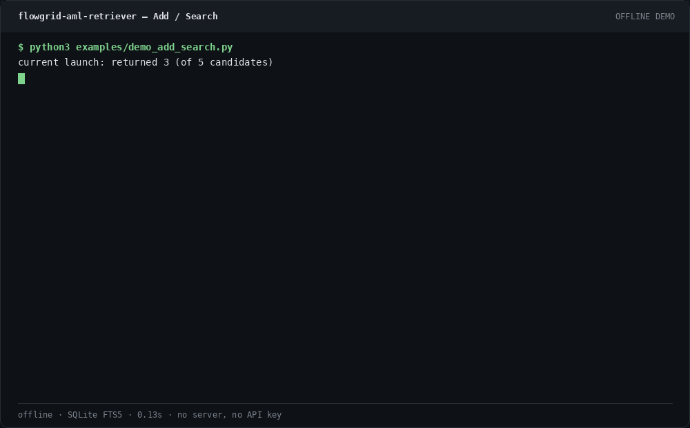

# flowgrid-aml-retriever

[](https://github.com/aidless/flowgrid-aml-retriever/actions/workflows/checks.yml)

> Repository: `flowgrid-aml-retriever` · service name: `just-agent` · package `1.1.0` · HTTP banner `aml-retriever/1.1`.

[](LICENSE)

[中文说明](README.zh-CN.md) · [API contract](docs/API_CONTRACT.md) ·
[Evaluation methodology](docs/EVAL.md) · [Failure modes](docs/FAILURE_MODES.md) ·
[Data lifecycle](docs/DATA_LIFECYCLE.md)

## STATUS: WORK-IN-PROGRESS — not A yet

Submitted to the Agent Memory Leaderboard (Text Memory · Open-source / Academic Methods) as a first-time entry. There is no official score. This file will not invent one. Local synthetic Recall and MRR are not that score.

Still open:

- No official leaderboard score. The entry is unscored.
- LoCoMo-style and DeepSeek notes below cite datasets that are not in this clone. `scripts/run_eval.py` does not reproduce them.
- Current `DEFAULT_FLAGS` enable `ebbinghaus_decay` and `consolidation_dedup`. The historical L12 row in the table below was not measured with that flag set.

## Problem

just-agent guarantees a synchronous Add (the write is stored and searchable before success) and a Search that returns ranked source evidence for exactly one `user_id`.
It does not generate an answer, does not delete older evidence when a fact changes, and has no official Agent Memory Leaderboard score.
The tests lock that contract; other numbers in this repository are development evidence only.

## Offline demo (no server)

No API key and no third-party package. The database stays in memory. This path does not start HTTP.

```bash
git clone https://github.com/aidless/flowgrid-aml-retriever.git
cd flowgrid-aml-retriever
python3 examples/demo_add_search.py
```



The demo adds three messages, prints two searches, and checks that a second user gets zero hits.

## Tests and CI

pytest collects 264 tests in `tests/` (unittest discover reports Ran 260 when the four Ollama tests are a class-level skip).

- [`.github/workflows/checks.yml`](.github/workflows/checks.yml) — Python 3.10 and 3.12. First `python -m unittest discover -s tests` (no extra packages), then `python -m pytest tests`.
- [`.github/workflows/ci.yml`](.github/workflows/ci.yml) — Python 3.12, `python -m pytest tests`, a mutation control that must fail on a corrupted test file, and gitleaks.

```bash
python3 examples/demo_add_search.py
python3 -m unittest discover -s tests
python3 -m pytest tests -q
./scripts/run_tests.sh
```

`./scripts/run_tests.sh` is the environment check, the unit suite, a CLI self-check, and 31 HTTP smoke checks. It does not run the ablation unless you pass `--with-eval`. Pytest is optional for a fresh clone; the demo and unittest need only the standard library and SQLite FTS5. `pytest.ini` sets `testpaths = tests` so `examples/test_*.py` are not part of the count.

## HTTP server (separate path)

Python 3.10 or newer (the checks workflow runs 3.10 and 3.12) with SQLite FTS5. No `pip install` for the server itself.

```bash
./scripts/serve.sh
```

The process listens on `127.0.0.1:8080` and uses `./aml.db`. Contract checks against a throwaway server:

```bash
python3 scripts/smoke_api.py
```

### Add a memory

```bash
curl -sS http://127.0.0.1:8080/add \
  -H 'Content-Type: application/json' \
  -d '{
    "request_id": "req-1",
    "user_id": "user-1",
    "session_id": "session-1",
    "messages": [
      {
        "role": "user",
        "timestamp": 1785945600000,
        "content": "The launch date moved to August 14, 2026."
      }
    ]
  }'
```

Successful `Add` responses are returned only after the memory is durable and
searchable:

```json
{
  "success": true,
  "request_id": "req-1",
  "user_id": "user-1",
  "session_id": "session-1"
}
```

### Search for evidence

```bash
curl -sS http://127.0.0.1:8080/search \
  -H 'Content-Type: application/json' \
  -d '{
    "query": "When is the launch?",
    "user_id": "user-1",
    "top_k": 10
  }'
```

```json
{
  "data": [
    {
      "id": "...",
      "content": "The launch date moved to August 14, 2026.",
      "score": 12.34,
      "created_at": "2026-08-05T16:00:00Z",
      "view": "message",
      "source_message_ids": ["..."],
      "evidence_flags": ["lexical"]
    }
  ]
}
```

`score` in the sample is a response-shape placeholder, not a measured result. `view`, `source_message_ids`, and `evidence_flags` provide optional provenance.
Set `AML_INCLUDE_PROVENANCE=0` to omit them.

## What it does

- Synchronously persists each `Add` request before returning success.
- Makes newly added memories immediately searchable.
- Enforces strict retrieval isolation by `user_id`.
- Replays duplicate `(request_id, user_id)` writes idempotently.
- Preserves every original message and links derived views back to source IDs.
- Combines SQLite FTS5, Chinese character n-grams, exact entities, numbers,
  dates, temporal signals, adjacency, reciprocal-rank fusion, and deduplication.
- Applies guarded temporal supersession as a soft ranking signal; older evidence
  remains stored and retrievable.
- Falls back to content/anchor-derived event times when a message has no
  timestamp (`temporal_fallback`), and prefixes returned evidence with a
  day-level event date when the query has temporal context
  (`content_timestamp_prefix`, gated by `has_temporal_context`) so the answer
  model can use it on temporal questions without altering stored text.
- Runs with Python's standard library and SQLite FTS5, with no third-party
  Python package in the default path.

## Architecture

```text
HTTP Add/Search
      │
      ▼
Contract validation and field mapping
      │
      ▼
Memory service
  ├─ user isolation
  ├─ idempotency
  └─ deletion lifecycle
      │
      ▼
Evidence retriever
  ├─ original messages
  ├─ sliding windows
  ├─ session segments
  ├─ FTS5 and deterministic features
  └─ fusion, temporal reranking, provenance, deduplication
      │
      ▼
Ranked source evidence — no answer generation
```

The HTTP wrapper is intentionally separate from the retrieval engine. Protocol
changes remain in `api.py` and `server.py`; storage and ranking stay independently
testable.

## Docker

```bash
docker build -t flowgrid-aml-retriever:local .

# Verify FTS5 and the full test suite inside the image
docker run --rm flowgrid-aml-retriever:local \
  python -c "import sqlite3; sqlite3.connect(':memory:').execute('create virtual table t using fts5(x)'); print('FTS5 OK')"
docker run --rm flowgrid-aml-retriever:local \
  python -m unittest discover -s tests
docker run --rm flowgrid-aml-retriever:local \
  python scripts/smoke_api.py

# Persistent service
docker run --rm -p 8080:8080 \
  -v "$PWD/data:/data" \
  -e AML_DB_PATH=/data/aml.db \
  flowgrid-aml-retriever:local
```

The container runs as a non-root user and exposes an unauthenticated `/health`
endpoint. Bearer, Token, and `X-Api-Key` authentication are available for Add,
Search, statistics, and deletion endpoints.

## Retrieval pipeline

1. **Persist original evidence.** Messages are stored unchanged, with stable
   IDs and request-level idempotency.
2. **Build multiple views.** Message, sliding-window, and session-segment views
   provide different recall surfaces without replacing the source messages.
3. **Generate candidates.** FTS5 retrieval uses Latin tokens, numbers, dates,
   and Chinese unigrams/bigrams; optional answer choices can contribute query
   terms.
4. **Score deterministic signals.** Exact substrings, token coverage, entities,
   numbers, dates, recency, and neighboring context contribute independent
   evidence.
5. **Handle updates conservatively.** A newer near-duplicate receives a soft
   boost only when the query is temporal and explicit update language is
   present. The earlier evidence is demoted, never deleted.
6. **Fuse and deduplicate.** Weighted reciprocal-rank fusion combines lexical
   and feature ranks before deterministic tie-breaking.

All ranking controls live in `RetrieverConfig` and can be disabled independently
for ablation.

## Evaluation

The table is a historical local run of the synthetic `classic` suite (medium, mixed, seeds 20260806–20260808, `top_k=100`) via `scripts/run_eval.py`. It is not an official score. The L11 and L12 rows match because that run did not include today's extra default flags `ebbinghaus_decay` and `consolidation_dedup`. This repository has no re-measurement of the current flag set, so the L12 row is not the current default. Limits: [docs/FAILURE_MODES.md](docs/FAILURE_MODES.md) and [docs/EVAL.md](docs/EVAL.md).

`classic`, medium, mixed difficulty, seeds 20260806–20260808, `top_k=100`:

| Configuration | Recall@20 mean (range) | Recall@100 | MRR mean (range) |
| --- | ---: | ---: | ---: |
| L5 baseline (`L5_plus_weighted_rrf`) | 0.9948 (0.9870–1.0000) | 1.0000 | 0.6728 (0.6631–0.6791) |
| L9 guarded supersession (`L9_guarded_supersession`) | 0.9948 (0.9870–1.0000) | 1.0000 | 0.6948 (0.6854–0.7004) |
| historical L11 snapshot (`L11_v12_production`) | 0.9983 (0.9948–1.0000) | 1.0000 | 0.7785 (0.7427–0.8020) |
| historical L12 snapshot, not today's flags (`L12_v13_production`) | 0.9983 (0.9948–1.0000) | 1.0000 | 0.7785 (0.7427–0.8020) |

Unverified external notes, not rerun from this clone (`locomo10.json` is not in the tree; `scripts/run_eval.py` does not produce these figures): a LoCoMo-style note says v1.2 moved Recall@20 from 0.8958 to 0.9014, Recall@100 from 0.9540 to 0.9580, and MRR from 0.6186 to 0.6203 (1977 queries, `top_k=100`). A DeepSeek note (flash answers, pro judge, 297-item sample) says 0.6229 vs 0.5724, with a later gated-prefix note of +1.35 pp on that same local sample. A further note says a code-level recency weight (plain queries 2.0 instead of 8.0) moved locomo10 MRR from 0.6203 to 0.6324 and a synthetic L9 MRR from 0.6854 to 0.7281. Treat every one of those as an unscored local note.

`preference_role_boost` was enabled briefly and then turned back off after paired same-sample checks (slices 50/100/200, bit-identical with the flag off) showed the apparent gain was sample variance. It stays off. None of this is an official score.

Reproduce a run with:

```bash
python3 scripts/run_eval.py \
  --scale medium \
  --difficulty mixed \
  --suite classic \
  --seeds 20260806,20260807,20260808 \
  --top-k 100
```

Generated reports are written to the ignored `eval_out/` directory. See
[docs/EVAL.md](docs/EVAL.md) for metric definitions, controls, known regressions,
and the full ablation history.

## Privacy and deletion

- Memory content is never written to service logs.
- Searches are scoped to exactly one `user_id`.
- `/health` and `/stats` never return memory content.
- Configuration rendering redacts authentication secrets.
- `delete-user` removes messages, views, FTS rows, request records, and session
  cursors for one user.
- `purge --yes` clears the complete database.

```bash
python3 -m aml_retriever.cli delete-user --db ./aml.db --user user-1
python3 -m aml_retriever.cli purge --db ./aml.db --yes
```

For file-backed SQLite, remove the database together with its `-wal` and `-shm`
files when destroying an instance. See [docs/DATA_LIFECYCLE.md](docs/DATA_LIFECYCLE.md).

The repository contains synthetic fixtures and handwritten examples only; it
does not contain leaderboard evaluation data.

## Known limitations

- The default retrieval path is lexical and deterministic. Semantically distant
  paraphrases, especially temporal paraphrases, remain the main weakness.
- Guarded supersession is a ranking signal, not truth resolution. Conflicting
  and historical evidence remains available by design.
- Chinese tokenization uses character unigrams and bigrams rather than a
  language model or full morphological segmenter.
- SQLite is a single-node backend. WAL mode, retries, and a read pool handle the
  evaluated concurrency shape, but the implementation is not horizontally
  distributed.
- Synthetic evaluation supports controlled comparison. It is not an official score. See [docs/FAILURE_MODES.md](docs/FAILURE_MODES.md).

## Repository layout

```text
aml_retriever/
  api.py          Add/Search contract and memory service
  server.py       HTTP transport
  retriever.py    storage, candidate generation, scoring, and reranking
  views.py        message, window, and session-segment views
  features.py     deterministic feature extraction
  config.py       configuration and ablation flags
  store.py        lexical baseline retained for regression testing
  cli.py          service, data, and self-check commands
  evaluation/     synthetic datasets, metrics, and ablation harness
scripts/
  serve.sh        local service launcher
  run_tests.sh    complete local verification
  smoke_api.py    HTTP contract smoke suite
  run_eval.py     reproducible ablation runner
  run_scan.py     parameter scan runner
docs/
  API_CONTRACT.md
  EVAL.md
  FAILURE_MODES.md
  DATA_LIFECYCLE.md
Dockerfile
config.example.json
```

## Project boundary

just-agent is an independent, self-contained leaderboard implementation focused on
deterministic, evidence-first memory retrieval. It applies ideas of provenance,
temporal state, conflict preservation, and user isolation. It provides retrieval
evidence only and does not generate final answers.

## License

Licensed under the [MIT License](LICENSE).
