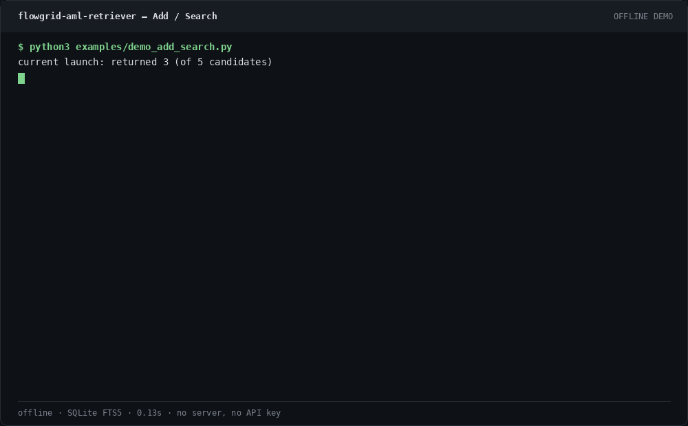

# flowgrid-aml-retriever

> 仓库：`flowgrid-aml-retriever` · 服务名：`just-agent` · 包版本 `1.1.0` · HTTP 标识 `aml-retriever/1.1`。

[English](README.md) · [API 契约](docs/API_CONTRACT.md) ·
[评测方法](docs/EVAL.md) · [失败模式](docs/FAILURE_MODES.md) ·
[数据生命周期](docs/DATA_LIFECYCLE.md)

## STATUS: WORK-IN-PROGRESS — not A yet

以首次提交身份参加 Agent Memory Leaderboard（文本记忆 · 开源 / 学术方法）。no official score。本文不会编造官方分数。本地合成 Recall / MRR 不是该分数。

仍未闭合：

- 没有官方榜单分数。
- 下文 LoCoMo / DeepSeek 数字来自本仓库未收录的数据；`scripts/run_eval.py` 不能复现它们。
- 当前 `DEFAULT_FLAGS` 还打开了 `ebbinghaus_decay` 与 `consolidation_dedup`。下面表格里的 L12 行不是这组开关的测量。

## 问题

just-agent 保证同步 Add（成功返回前已写入且可检索），以及只返回某一个 `user_id` 的排序来源证据的 Search。
它不生成答案，事实变化时不删除旧证据，也没有官方 Agent Memory Leaderboard 分数。
测试锁定的是这份契约；仓库里的其他数字只是开发证据。

## 离线 demo（不起服务）

不需要 API key，不需要第三方包，数据库在内存中。这条路径不启动 HTTP。

```bash
git clone https://github.com/aidless/flowgrid-aml-retriever.git
cd flowgrid-aml-retriever
python3 examples/demo_add_search.py
```



demo 写入 3 条消息，打印两次检索，并检查另一个用户得到 0 条。

## 测试与 CI

pytest collects 264 tests in `tests/` (unittest discover reports Ran 260 when the four Ollama tests are a class-level skip).

- [`.github/workflows/checks.yml`](.github/workflows/checks.yml)：Python 3.10 与 3.12。先 `python -m unittest discover -s tests`（无额外包），再 `python -m pytest tests`。
- [`.github/workflows/ci.yml`](.github/workflows/ci.yml)：Python 3.12，`python -m pytest tests`，一次必须失败的变异对照，以及 gitleaks。

```bash
python3 examples/demo_add_search.py
python3 -m unittest discover -s tests
python3 -m pytest tests -q
./scripts/run_tests.sh
```

`./scripts/run_tests.sh` 做环境检查、单元测试、CLI 自检和 31 项 HTTP smoke。不加 `--with-eval` 就不会跑消融。全新克隆跑 demo 和 unittest 不需要 pip。`pytest.ini` 的 `testpaths = tests` 把 `examples/test_*.py` 排除在计数之外。

## HTTP 服务（与 demo 分开）

需要 Python 3.10+（checks 工作流跑 3.10 与 3.12）以及带 FTS5 的 SQLite。服务本身不需要 `pip install`。

```bash
./scripts/serve.sh
```

默认监听 `127.0.0.1:8080`，数据库为 `./aml.db`。对临时服务做契约检查：

```bash
python3 scripts/smoke_api.py
```

### Add

```bash
curl -sS http://127.0.0.1:8080/add \
  -H 'Content-Type: application/json' \
  -d '{
    "request_id": "req-1",
    "user_id": "user-1",
    "session_id": "session-1",
    "messages": [
      {
        "role": "user",
        "timestamp": 1785945600000,
        "content": "发布日期调整为 2026 年 8 月 14 日。"
      }
    ]
  }'
```

只有在数据已经落库并可检索后，接口才返回成功：

```json
{
  "success": true,
  "request_id": "req-1",
  "user_id": "user-1",
  "session_id": "session-1"
}
```

### Search

```bash
curl -sS http://127.0.0.1:8080/search \
  -H 'Content-Type: application/json' \
  -d '{
    "query": "发布日期是什么时候？",
    "user_id": "user-1",
    "top_k": 10
  }'
```

```json
{
  "data": [
    {
      "id": "...",
      "content": "发布日期调整为 2026 年 8 月 14 日。",
      "score": 12.34,
      "created_at": "2026-08-05T16:00:00Z",
      "view": "message",
      "source_message_ids": ["..."],
      "evidence_flags": ["lexical"]
    }
  ]
}
```

示例里的 `score` 只说明响应形状，不是实测分数。`view`、`source_message_ids` 与 `evidence_flags` 是可选的来源追踪字段；设置
`AML_INCLUDE_PROVENANCE=0` 可关闭。

## 核心能力

- `Add` 成功返回前同步持久化，写入后立即可检索；
- 以 `user_id` 为严格检索边界；
- `(request_id, user_id)` 重复写入保持幂等；
- 原始消息完整保留，派生视图可回指来源消息 ID；
- 融合 SQLite FTS5、中文字符 n-gram、实体/数字/日期精确特征、时间与邻接信号、
  RRF 和去重；
- 只将受保护的事实更新作为软重排信号，旧证据不删除；
- 缺失时间戳时按正文/会话锚点推导事件时间（`temporal_fallback`），并给返回证据
  加日级事件时间前缀（`content_timestamp_prefix`），帮助答案模型处理时间问题；
- 默认路径只使用 Python 标准库与 SQLite FTS5，不依赖第三方 Python 包。

## 架构

```text
HTTP Add/Search
      │
      ▼
契约校验与字段映射
      │
      ▼
Memory Service
  ├─ 用户隔离
  ├─ 幂等
  └─ 删除生命周期
      │
      ▼
Evidence Retriever
  ├─ 原始消息
  ├─ 滑动窗口
  ├─ 会话片段
  ├─ FTS5 与确定性特征
  └─ 融合、时间重排、来源追踪、去重
      │
      ▼
按相关性排序的原始证据，不生成答案
```

HTTP wrapper 与检索引擎分层：协议变化集中在 `api.py` 和 `server.py`，存储与排序逻辑
可以独立测试。

## Docker

```bash
docker build -t flowgrid-aml-retriever:local .

docker run --rm flowgrid-aml-retriever:local \
  python -c "import sqlite3; sqlite3.connect(':memory:').execute('create virtual table t using fts5(x)'); print('FTS5 OK')"
docker run --rm flowgrid-aml-retriever:local \
  python -m unittest discover -s tests
docker run --rm flowgrid-aml-retriever:local \
  python scripts/smoke_api.py

docker run --rm -p 8080:8080 \
  -v "$PWD/data:/data" \
  -e AML_DB_PATH=/data/aml.db \
  flowgrid-aml-retriever:local
```

容器以非 root 用户运行，并提供无需鉴权的 `/health`。Add、Search、统计和删除端点
支持 Bearer、Token 与 `X-Api-Key` 鉴权。

## 检索流程

1. **保存原始证据**：消息不改写，使用稳定 ID，并在请求级保证幂等。
2. **建立多种视图**：单消息、滑动窗口和会话片段提供不同的召回入口，但不替代原文。
3. **候选召回**：FTS5 使用拉丁词、数字、日期以及中文 unigram/bigram；选择题选项可参与查询。
4. **确定性特征打分**：精确子串、token 覆盖率、实体、数字、日期、新近度和邻接上下文分别计分。
5. **保守处理更新**：只有同时满足时间查询、近重复事实与显式更新语义时，才软提升新证据、
   降低旧证据；历史证据始终保留。
6. **融合与去重**：加权 RRF 融合词法与特征名次，再以确定性规则处理同分与重复结果。

全部增强开关都位于 `RetrieverConfig`，可以单独关闭做消融。

## 评测

下表是合成 `classic` 套件的一次历史本地运行（medium / mixed / seeds 20260806–20260808 / `top_k=100`，命令为 `scripts/run_eval.py`）。它不是官方分数。L11 与 L12 两行相同，是因为那次运行还没有把今天默认打开的 `ebbinghaus_decay` 和 `consolidation_dedup` 算进去。本仓库没有这组开关的复测，因此 L12 行不是当前默认的分数。限制见 [docs/FAILURE_MODES.md](docs/FAILURE_MODES.md) 与 [docs/EVAL.md](docs/EVAL.md)。

`classic` / medium / mixed / seeds 20260806–20260808 / `top_k=100`：

| 配置 | Recall@20 mean（范围） | Recall@100 | MRR mean（范围） |
| --- | ---: | ---: | ---: |
| L5 基线（`L5_plus_weighted_rrf`） | 0.9948（0.9870–1.0000） | 1.0000 | 0.6728（0.6631–0.6791） |
| L9 受保护覆写（`L9_guarded_supersession`） | 0.9948（0.9870–1.0000） | 1.0000 | 0.6948（0.6854–0.7004） |
| 历史 L11 快照（`L11_v12_production`） | 0.9983（0.9948–1.0000） | 1.0000 | 0.7785（0.7427–0.8020） |
| 历史 L12 快照，不是今天的默认开关（`L12_v13_production`） | 0.9983（0.9948–1.0000） | 1.0000 | 0.7785（0.7427–0.8020） |

以下是未能在本克隆中重跑的外部笔记（树里没有 `locomo10.json`，`scripts/run_eval.py` 不会产出这些数字）：一份 LoCoMo 风格笔记称 v1.2 将 Recall@20 从 0.8958 调到 0.9014、Recall@100 从 0.9540 调到 0.9580、MRR 从 0.6186 调到 0.6203（1977 条查询，`top_k=100`）。一份 DeepSeek 笔记（flash 作答、pro 评判、297 条抽样）称 0.6229 对 0.5724，随后的门控前缀笔记为同一样本 +1.35 个百分点。另一份笔记称代码层新近度（纯文本查询 2.0 而非 8.0）把 locomo10 MRR 从 0.6203 调到 0.6324，并把合成 L9 MRR 从 0.6854 调到 0.7281。这些都不是官方分数。

`preference_role_boost` 曾短暂打开，配对同样本（50/100/200，与关闭逐位一致）表明表观增益是样本方差，现已默认关闭。

```bash
python3 scripts/run_eval.py \
  --scale medium \
  --difficulty mixed \
  --suite classic \
  --seeds 20260806,20260807,20260808 \
  --top-k 100
```

报告会生成到已忽略的 `eval_out/`。完整指标定义、对照组、回退案例和消融历史见
[docs/EVAL.md](docs/EVAL.md)。

## 隐私与删除

- 服务日志不记录记忆正文；
- Search 只能访问一个明确的 `user_id`；
- `/health` 与 `/stats` 不返回记忆内容；
- 配置输出会隐藏鉴权密钥；
- `delete-user` 会清除该用户的消息、视图、FTS 行、请求记录与会话游标；
- `purge --yes` 会清空整个数据库。

```bash
python3 -m aml_retriever.cli delete-user --db ./aml.db --user user-1
python3 -m aml_retriever.cli purge --db ./aml.db --yes
```

销毁文件型 SQLite 实例时，还应同时删除同名 `-wal` 与 `-shm` 文件。详见
[docs/DATA_LIFECYCLE.md](docs/DATA_LIFECYCLE.md)。

本仓库只含合成 fixture 与手写示例，不含排行榜评测数据。

## 已知限制

- 默认路线是确定性词法检索，语义距离较远的改写，尤其时间类改写，仍是主要短板；
- 受保护覆写是排序信号，不是真值裁决，冲突与历史证据会按设计继续保留；
- 中文分词采用字符 unigram/bigram，不是语言模型或完整形态学分词；
- SQLite 是单机后端。WAL、重试和读连接池可处理已验证的并发形态，但系统不支持横向分布式扩展；
- 合成评测只适合受控比较，不是官方分数。见 [docs/FAILURE_MODES.md](docs/FAILURE_MODES.md)。

## 仓库结构

```text
aml_retriever/
  api.py          Add/Search 契约与领域服务
  server.py       HTTP 传输层
  retriever.py    存储、召回、打分与重排
  views.py        单消息、滑窗与会话片段视图
  features.py     确定性特征抽取
  config.py       配置与消融开关
  store.py        用于回归的词法基线
  cli.py          服务、数据与自检命令
  evaluation/     合成数据、指标与消融评测台
scripts/
  serve.sh        本地服务启动
  run_tests.sh    完整本地验收
  smoke_api.py    HTTP 契约 smoke
  run_eval.py     可复现消融
  run_scan.py     参数扫描
docs/
  API_CONTRACT.md
  EVAL.md
  FAILURE_MODES.md
  DATA_LIFECYCLE.md
Dockerfile
config.example.json
```

## 项目边界

just-agent 是一个独立、自包含的排行榜实现，专注于确定性、证据优先的记忆检索。
它采用来源追踪、时间状态、冲突保留和用户隔离等思想；只提供检索证据，
不生成最终答案。

## 许可证

本项目采用 [MIT License](LICENSE)。
